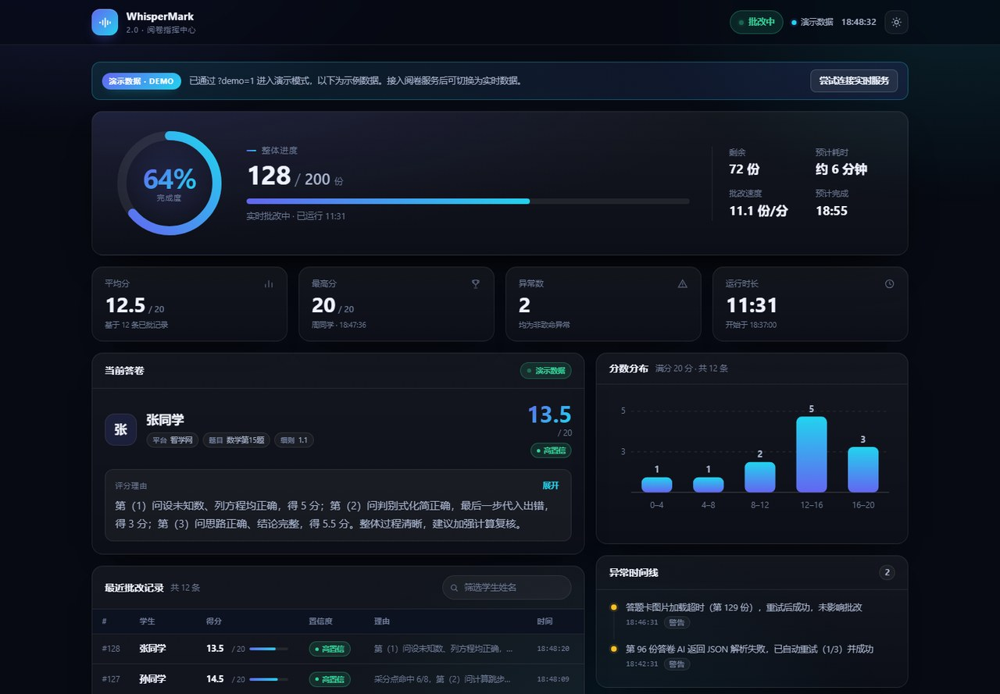
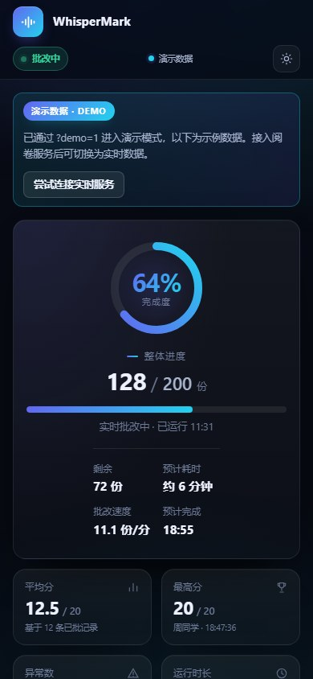

# WhisperMark 2.0

> Agent 驱动的多平台 AI 阅卷：**DSH / workbuddy 插件 + 命令行 CLI**。
> 评分细则锚定，批量批改不漂分；晚上挂机睡觉，早上起来全改完。

[](https://www.python.org/)
[](LICENSE)
[](dsh-plugin/)
[](https://playwright.dev/)
[](tests/)



## 目录

- [这是什么](#这是什么)
- [两种用法](#两种用法)
- [核心特性](#核心特性)
- [快速开始](#快速开始)
- [实时监控页](#实时监控页)
- [评分细则锚定（防幻觉核心）](#评分细则锚定防幻觉核心)
- [workbuddy / DSH 插件](#workbuddy--dsh-插件)
- [Token 消耗与费用估算](#token-消耗与费用估算)
- [项目结构](#项目结构)
- [测试](#测试)
- [常见问题](#常见问题)
- [2.0 更新了什么](#20-更新了什么)
- [License](#license)
- [免责声明](#免责声明)

## 这是什么

WhisperMark 2.0 是 [WhisperMark](https://github.com/72-hour/WhisperMark)（Python + Playwright 阅卷引擎）与 AI-Marker-Suite（多平台适配）的融合体：

- **CLI 版**：Playwright 直接操作智学网 / 阅小二的答题卡页面，自动填分、提交、换卷，浏览器可最小化后台挂机；
- **插件版（workbuddy / DSH）**：在 DeepSeek Harness 中注册 `wm_probe` 工具，按「题干 → 评分细则 → 整批答卷」流程批量给分，适合一次上传上千张答题卡。

当前支持平台：**智学网**（iframe 微前端）、**阅小二**（Vue3 + Element Plus）。

## 两种用法

| 用法 | 适合场景 | 入口 |
|------|---------|------|
| **workbuddy / DSH 插件**（教师免费） | 已有答题卡图片，想让 Agent 批量给分、生成评分细则 | `dsh-plugin/` → 工具 `wm_probe` |
| **CLI 浏览器阅卷** | 想在智学网 / 阅小二上自动填分、提交、无人值守挂机 | `python main.py grade ...` |

两者共用同一套 `wm` 引擎与同一份「细则锚定」逻辑，插件和 CLI 不会出现两套 prompt 漂移。

## 核心特性

- **AI 多模态评分**：识别手写答题卡，逐采分点给分，输出理由与置信度
- **评分细则锚定（防幻觉）**：细则结构化落盘 `data/rubrics/*.json` + 版本号 + 锁定，批改中禁止 AI 重写
- **Playwright 自动化**：直接操作 DOM，不占鼠标键盘，浏览器可最小化后台挂机
- **实时监控面板**：本地端口 + SSE 实时推送，进度 / 得分 / 异常一目了然（深/浅色、移动端、演示数据）
- **虚拟批改演示**：`python main.py demo` 不装浏览器、不配 AI Key 也能完整跑一遍并看到监控页
- **微信推送**：开始 / 进度 / 异常 / 完成自动推送（workbuddy 小龙虾等任意 webhook）
- **历史导出**：CSV / JSON / HTML 三种格式（HTML 报告已做转义与排版）

## 快速开始

### 1. 安装

```bash
git clone https://github.com/72-hour/WhisperMark.git
cd WhisperMark
pip install -r requirements.txt
playwright install chromium        # 只做插件批量评分可跳过
```

### 2. 配置 AI（DeepSeek 为例）

```bash
copy .env.example .env
```

```ini
# .env
WM_AI_API_KEY=sk-xxx
WM_AI_BASE_URL=https://api.deepseek.com/v1
WM_AI_MODEL=deepseek-chat
```

兼容任意 OpenAI 兼容接口（DeepSeek / Qwen-VL / 火山引擎 / 硅基流动等），也兼容旧的 `AI_API_KEY` 变量名。

### 3. 先看效果（无需登录、无需 AI Key）

```bash
python main.py check-env     # 环境自检
python main.py demo          # 虚拟批改 200 份，自动打开监控页
```

打开终端打印的地址（默认 <http://127.0.0.1:8321>）即可看到实时监控。

### 4. 生成评分细则（教师确认）

```bash
python main.py analyze-question --image 题干.jpg --platform zhixue --max-score 20 --question-id 数学第15题
# 教师检查 data/rubrics/数学第15题.md 后锁定：
python main.py analyze-question --image 题干.jpg --platform zhixue --max-score 20 --question-id 数学第15题 --confirm
```

### 5. 真实阅卷

```bash
# 交互式：手动登录 → 进入阅卷中心 → 选择题目 → 回车开始
python main.py grade --platform zhixue --rubric-id 数学第15题

# 无人值守（已登录过，cookies 已保存）：直接指定阅卷页 URL
python main.py grade --platform zhixue --url "<阅卷页URL>" --rubric-id 数学第15题 --total 200 --auto

# 导出报告
python main.py export --format html --output 批改报告.html
```

> 首次登录需要人工完成（验证码等），之后 cookies 会保存到 `data/cookies.json`，才能 `--auto` 挂机。
> 当前 CLI 按「一题一个总分填分框」的答题卡工作；如果是分小题多个分数框，需要按页面结构适配（见 FAQ）。

## 实时监控页

`web/monitor.html` 由本地 HTTP 服务在 `/` 返回，通过 SSE 实时刷新：

| 地址 | 说明 |
|------|------|
| `/` | 阅卷实时监控页 |
| `/dashboard` | 项目展示页 |
| `/api/state` | 当前状态 JSON（轮询兜底） |
| `/api/health` | 健康检查 |
| `/events` | SSE 事件流 |



- 端口默认 `8321`，被占用自动顺延；可用 `--port` / `--monitor-port` 指定
- 直接双击打开 `web/monitor.html` 或加 `?demo=1` 会进入演示数据模式（方便先看设计）
- 深色 / 浅色主题、SSE 指数退避重连、轮询兜底、360px 移动端布局

## 评分细则锚定（防幻觉核心）

1. **生成**：AI 分析题干，产出结构化采分点（`id` / `description` / `score` / `keywords`）
2. **确认**：导出独立 MD 供教师检查，确认后锁定 + 版本号 +0.1
3. **落盘**：`data/rubrics/{question_id}.json`（机器读取锚点）
4. **强制复用**：批改时每份答卷的 system prompt 注入同一份锁定细则，禁止 AI 凭空造分

细则自洽性校验：采分点分值之和 ≠ 满分时，生成 / 加载都会给出警告，提醒教师核对。

## workbuddy / DSH 插件

`dsh-plugin/` 是 DeepSeek Harness 插件（工具名 `wm_probe`，workbuddy 目前对教师免费）。加载后在对话里说：

> 帮我批改这些答题卡：题干是 `题干.jpg`，答卷在 `D:\答题卡\` 目录。

工具会按固定流程执行：

1. `action=check_env` 自检环境；
2. `action=analyze_question` 传题干图片，生成标准答案 / 解析 / 评分细则 `scoring_rubric`；
3. `action=grade` 传答卷图片或目录 + 上一步的 `scoring_rubric`，整批复用同一份细则批量给分。

**安全约定**：整批答卷必须复用同一份 rubric，禁止为不同答卷临时改写评分细则，避免评分标准漂移（幻觉）。插件只返回「AI 建议分数」，提交到平台请走 CLI 或人工复核。

插件源码结构：

```
dsh-plugin/
├── package.json          # DSH 插件声明
├── cordis.patch.yml      # bundle patch：注册 wm-probe
├── lib/index.js          # defineTool -> wm_probe
└── scripts/
    ├── _bootstrap.py     # 定位 2.0 项目根目录 / 载入 wm 引擎
    ├── check_env.py
    ├── analyze_question.py
    └── grade_image.py    # 细则锚定批量给分
```

若插件不在仓库内运行，设置 `WHISPERMARK_HOME` 指向本项目根目录即可。手动验证：

```bash
python dsh-plugin/scripts/check_env.py
python dsh-plugin/scripts/analyze_question.py 题干.jpg --max-score 20
python dsh-plugin/scripts/grade_image.py 答题卡目录/ --max-score 20 --rubric "评分细则……"
```

## Token 消耗与费用估算

以批阅 **100 份答卷**为例（含 1 次题干分析）：

| 项目 | 估算值 |
|------|--------|
| 总输入 Token | 约 15~25 万（图片占大头） |
| 总输出 Token | 约 0.5~1 万 |
| 耗时 | 约 6~10 分钟 |

| 模型 | 输入价格 | 输出价格 | 预估总费用 |
|------|----------|----------|-----------|
| **DeepSeek（主力）** | ¥1 / 百万 token | ¥2 / 百万 token | **约 ¥0.2** |
| GPT-4o | $2.5 / 百万 token | $10 / 百万 token | 约 ¥3~4 |
| Qwen2.5-VL-72B（硅基流动） | 免费额度 | 免费额度 | ¥0 |

## 项目结构

```
WhisperMark/
├── main.py                 # CLI 入口
├── demo_monitor.py         # 演示入口（兼容旧命令）
├── wm/                     # 核心包
│   ├── config.py           # 配置（env/.env/命令行三层覆盖）
│   ├── browser.py          # Playwright 浏览器管理（含 stealth）
│   ├── demo.py             # 虚拟批改演示引擎
│   ├── engine/             # 引擎层：grader / ai_grader / rubric / state
│   ├── platforms/          # 平台适配器：zhixue / haoyuejuan / registry
│   ├── monitor/            # 监控服务器（HTTP + SSE）
│   ├── notify/             # 微信推送（异步队列）
│   └── utils/              # 图片处理、日志
├── dsh-plugin/             # workbuddy / DSH 插件（wm_probe）
├── web/                    # dashboard.html / monitor.html
├── skill/SKILL.md          # Agent Skill（CodeBuddy / workbuddy）
├── tests/                  # pytest 测试套件（114 例）
├── docs/                   # 截图 + 示例报告
├── data/                   # 运行时数据（rubrics / history，已 gitignore）
└── runtime/monitor/        # 临时监控文件（启动自动生成）
```

## 测试

```bash
pip install pytest
python -m pytest tests -q      # 114 passed
```

覆盖：配置覆盖、细则生成/锁定/加载、AI 返回解析容错、状态机、监控服务器生命周期与 SSE、CLI 参数、导出转义、虚拟演示流程、批改循环竞态。修复清单与残余风险见 [BUGFIXES.md](BUGFIXES.md)。

## 常见问题

**Q：没有 AI Key / 没装 Chromium 能跑吗？**
A：可以跑 `python main.py demo` 和 `check-env`；真实阅卷需要 AI Key + Chromium + 平台账号。

**Q：打开监控页看不到内容？**
A：先运行 `python main.py demo` 或 `python main.py monitor`（监控服务随进程存活）；端口被占用时以终端打印的实际地址为准。

**Q：答题卡是分小题多个分数框怎么办？**
A：当前 CLI 按「一题一个总分填分框」实现。分小题页面需要按真实 DOM 适配（`wm/platforms/` 下的选择器与填分逻辑），欢迎提 Issue 附页面截图/HTML。

**Q：为什么用 Playwright 而不是鼠标脚本？**
A：直接操作 DOM，不占用鼠标键盘；浏览器可最小化，批阅时照常使用电脑。

**Q：AI 评分能直接当最终成绩吗？**
A：不能。AI 结果仅供参考，请教师复核；低置信度 / 异常记录会在监控页与导出报告中标注。

## 2.0 更新了什么

- 全新监控页（深/浅色、进度环、KPI、分数分布、异常时间线、可搜索记录表、演示模式）
- 新增 `python main.py demo`：无浏览器 / 无 AI Key 的虚拟批改演示
- 修复 Playwright 同步 API 跨线程导致的真实阅卷必崩问题；修复自动批改竞态、监控服务器生命周期、`--platform auto` 失效、`--max-score` 被忽略、HTML 导出 XSS 等问题
- 微信推送改异步不阻塞批改；AI 解析容错与分数钳制；可选依赖惰性导入
- 新增 `tests/`（114 例）、`.gitignore`、`BUGFIXES.md`

## License

[MIT License](LICENSE)

## 免责声明

本工具仅供学习交流使用。AI 评分结果仅供参考，教师应审核确认后再提交。使用本工具产生的任何后果由使用者自行承担，请遵守阅卷平台的使用条款；答题卡图片会发送到 AI 接口，请确保符合学校的数据合规要求。
